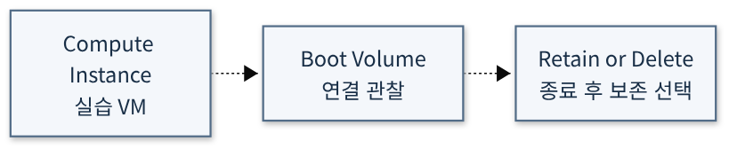

# Boot Volume

> Draft / 작성예정 — 문서 구조 준비용 초안입니다. 완성된 실습 가이드가 아닙니다.

## 학습목표

- Boot Volume에 포함되는 운영체제 이미지의 역할을 설명할 수 있다.[8][7]
- 인스턴스 종료 시 볼륨 보존과 다른 인스턴스에 연결하는 복구 방식을 확인할 수 있다.[8][7]

## 대응 Roadmap 항목

- 항목명: **Boot Volume**
- Roadmap 경로: **Compute → Boot Volume**
- Node ID: `sequence-2-3`
- 상위 항목: **Compute** (`sequence-2-0`)
- 문서 범위: 이 항목의 개념 학습목표와 공식 출처. 실습절차 및 실행 검증은 작성예정입니다.
- [전체 항목 목록](../README.md)

## 사전준비

작성예정 — 실습 내용은 아직 작성하지 않았습니다.

## 권한

작성예정 — 실습 내용은 아직 작성하지 않았습니다.

## 비용및주의사항

작성예정 — 해당 항목의 과금 조건과 안전 주의사항을 공식문서 기준으로 확인합니다. 이 초안만으로 리소스를 생성하지 마세요. 무료 사용을 보장하지 않습니다.

## 실습구성

> 아래는 Oracle 공식문서가 설명하는 기능을 기반으로 설계한 **권장 실습안**이며 Oracle이 공인·권장한 교육과정이라는 뜻은 아닙니다. 실제 OCI 실행·검증은 수행하지 않았습니다.

- **권장 실습:** Boot Volume 연결 관찰
- **실습 방식:** Console에서 전용 실습 리소스를 관찰·구성하는 방식. 아래 활동은 구성 제안이며 상세 실행절차는 별도 작성 대상이다.
  1. 실습 VM의 Boot Volume 상세와 연결·보존 옵션을 확인한다
  2. 공식문서의 해당 설정·제약과 관찰값을 대조한다.
  3. 아래 결과를 기록하고 선택 생성한 리소스의 정리 범위를 확인한다.
- **확인할 결과:** 인스턴스와 Boot Volume 연결 및 종료 시 보존 선택 기록
- **선행/연계 실습:** [Compute](00_Compute.md) — 문서 연계이며 모두 리소스 생성을 요구하는 필수 순서는 아니다.
- **주의/대체:** 로그인 가능한 OCI 계정과 해당 범위의 조회 권한이 필요하다. 생성·변경은 별도 승인된 전용 Compartment에서만 수행하며 권한·Region 지원·한도·현재 비용을 먼저 확인한다. 실습 후 생성 리소스의 삭제 대상과 보존 여부를 확인한다. 리소스가 없거나 생성 승인이 없으면 공식 예제 기반 구성표로 대체한다. SSH 허용 source는 본인의 공인 IP 범위로 제한하고 전체 인터넷에 SSH를 열지 않는다. private key·인증정보는 문서나 저장소에 넣지 않는다.
- **공식 근거:** [Overview of Block Volume — Boot Volume](https://docs.oracle.com/en-us/iaas/Content/Block/Concepts/overview.htm) · [Working with Boot Volumes — Boot Volume](https://docs.oracle.com/en-us/iaas/Content/Block/Concepts/bootvolumes.htm) · [Overview of Block Volume — Boot Volume](https://docs.oracle.com/en-us/iaas/Content/Block/Concepts/overview.htm) · [Working with Boot Volumes — Boot Volume](https://docs.oracle.com/en-us/iaas/Content/Block/Concepts/bootvolumes.htm)

- **학습용 계획도:** 아래는 이 권장 실습의 구성 요소·검토 관계를 나타내며 실제 배포도가 아닙니다. 점선은 학습·설정 관계이고 실제 패킷 경로나 자원 생성 순서를 보장하지 않습니다. 이번 문서 작성에서 실제 OCI 리소스는 생성하지 않았습니다.

[SVG 확대](../diagrams/13_Boot_Volume.svg) · [Mermaid 원본](../diagrams/13_Boot_Volume.mmd)

## 실습절차

작성예정 — 실습 내용은 아직 작성하지 않았습니다.

## 결과검증

작성예정 — 기대 결과와 검증 방법을 정의합니다. 실제 OCI 실습 실행 및 검증은 수행하지 않았습니다.

## 문제해결

작성예정 — 실습 내용은 아직 작성하지 않았습니다.

## 리소스정리

작성예정 — 실습 내용은 아직 작성하지 않았습니다.

## 공식문서

아래 Oracle 공식문서의 해당 항목 본문을 학습 근거로 사용합니다. 목표는 학습 후 설명·구분·확인할 내용이며 실제 OCI 실행 결과를 뜻하지 않습니다.

- [8] [Overview of Block Volume — Boot Volume](https://docs.oracle.com/en-us/iaas/Content/Block/Concepts/overview.htm)
  - 확인 범위: Boot volume:.

- [7] [Working with Boot Volumes — Boot Volume](https://docs.oracle.com/en-us/iaas/Content/Block/Concepts/bootvolumes.htm)
  - 확인 범위: About Boot Volumes / Troubleshooting and repair:.
