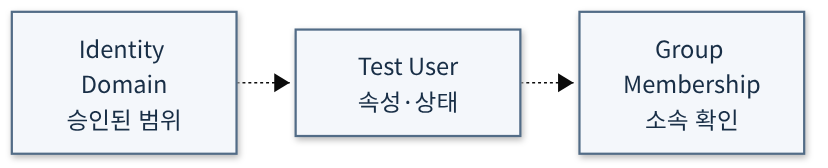

# Users

> Draft / 작성예정 — 문서 구조 준비용 초안입니다. 완성된 실습 가이드가 아닙니다.

## 학습목표

- User와 해당 User의 IAM 자격 증명의 역할을 설명할 수 있다.[25]
- 사용자 식별과 Group을 통한 권한 부여를 구분할 수 있다.[25]

## 대응 Roadmap 항목

- 항목명: **Users**
- Roadmap 경로: **Identity and Access Management (IAM) → Users**
- Node ID: `sequence-4-1`
- 상위 항목: **Identity and Access Management (IAM)** (`sequence-4-0`)
- 문서 범위: 이 항목의 개념 학습목표와 공식 출처. 실습절차 및 실행 검증은 작성예정입니다.
- [전체 항목 목록](../README.md)

## 사전준비

작성예정 — 실습 내용은 아직 작성하지 않았습니다.

## 권한

작성예정 — 실습 내용은 아직 작성하지 않았습니다.

## 비용및주의사항

작성예정 — 해당 항목의 과금 조건과 안전 주의사항을 공식문서 기준으로 확인합니다. 이 초안만으로 리소스를 생성하지 마세요. 무료 사용을 보장하지 않습니다.

## 실습구성

> 아래는 Oracle 공식문서가 설명하는 기능을 기반으로 설계한 **권장 실습안**이며 Oracle이 공인·권장한 교육과정이라는 뜻은 아닙니다. 실제 OCI 실행·검증은 수행하지 않았습니다.

- **권장 실습:** Identity Domain 테스트 사용자 관찰
- **실습 방식:** Console에서 전용 실습 리소스를 관찰·구성하는 방식. 아래 활동은 구성 제안이며 상세 실행절차는 별도 작성 대상이다.
  1. 승인된 실습 domain에서 사용자 속성·상태·그룹 소속을 확인하거나 테스트 사용자만 생성한다
  2. 공식문서의 해당 설정·제약과 관찰값을 대조한다.
  3. 아래 결과를 기록하고 선택 생성한 리소스의 정리 범위를 확인한다.
- **확인할 결과:** 사용자 상태와 domain·group 소속 기록
- **선행/연계 실습:** [Identity and Access Management (IAM)](00_Identity_and_Access_Management_IAM.md) — 문서 연계이며 모두 리소스 생성을 요구하는 필수 순서는 아니다.
- **주의/대체:** 로그인 가능한 OCI 계정과 해당 범위의 조회 권한이 필요하다. 생성·변경은 별도 승인된 전용 Compartment에서만 수행하며 권한·Region 지원·한도·현재 비용을 먼저 확인한다. 실습 후 생성 리소스의 삭제 대상과 보존 여부를 확인한다. 리소스가 없거나 생성 승인이 없으면 공식 예제 기반 구성표로 대체한다. 테스트 계정·그룹은 승인된 domain에서만 다룬다. Administrators 편입이나 tenancy 전체 관리 권한을 편의상 부여하지 않는다. 인증정보와 사용자 식별정보를 공개하지 않는다.
- **공식 근거:** [Overview of Identity and Access Management — Users](https://docs.oracle.com/en-us/iaas/Content/Identity/Concepts/overview.htm)

- **학습용 계획도:** 아래는 이 권장 실습의 구성 요소·검토 관계를 나타내며 실제 배포도가 아닙니다. 점선은 학습·설정 관계이고 실제 패킷 경로나 자원 생성 순서를 보장하지 않습니다. 이번 문서 작성에서 실제 OCI 리소스는 생성하지 않았습니다.

[SVG 확대](../diagrams/34_Users.svg) · [Mermaid 원본](../diagrams/34_Users.mmd)

## 실습절차

작성예정 — 실습 내용은 아직 작성하지 않았습니다.

## 결과검증

작성예정 — 기대 결과와 검증 방법을 정의합니다. 실제 OCI 실습 실행 및 검증은 수행하지 않았습니다.

## 문제해결

작성예정 — 실습 내용은 아직 작성하지 않았습니다.

## 리소스정리

작성예정 — 실습 내용은 아직 작성하지 않았습니다.

## 공식문서

아래 Oracle 공식문서의 해당 항목 본문을 학습 근거로 사용합니다. 목표는 학습 후 설명·구분·확인할 내용이며 실제 OCI 실행 결과를 뜻하지 않습니다.

- [25] [Overview of Identity and Access Management — Users](https://docs.oracle.com/en-us/iaas/Content/Identity/Concepts/overview.htm)
  - 확인 범위: USER .
