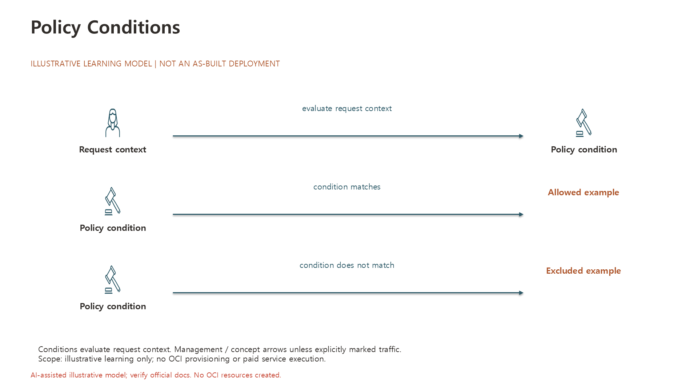

# Policy Conditions

> Draft / 작성예정 — 문서 구조 준비용 초안입니다. 완성된 실습 가이드가 아닙니다.

## 학습목표

- Policy Condition이 접근 권한을 제한하는 방식을 설명할 수 있다.[26]
- 조건 변수와 사용자 OCID 조건의 적용 대상을 해석할 수 있다.[26]

## 대응 Roadmap 항목

- 항목명: **Policy Conditions**
- Roadmap 경로: **Identity and Access Management (IAM) → Policy Conditions**
- Node ID: `sequence-4-7`
- 상위 항목: **Identity and Access Management (IAM)** (`sequence-4-0`)
- 문서 범위: 이 항목의 개념 학습목표와 공식 출처. 실습절차 및 실행 검증은 작성예정입니다.
- [전체 항목 목록](../README.md)

## 사전준비

작성예정 — 실습 내용은 아직 작성하지 않았습니다.

## 권한

작성예정 — 실습 내용은 아직 작성하지 않았습니다.

## 비용및주의사항

작성예정 — 해당 항목의 과금 조건과 안전 주의사항을 공식문서 기준으로 확인합니다. 이 초안만으로 리소스를 생성하지 마세요. 무료 사용을 보장하지 않습니다.

## 실습구성

> 아래는 Oracle 공식문서가 설명하는 기능을 기반으로 설계한 **권장 실습안**이며 Oracle이 공인·권장한 교육과정이라는 뜻은 아닙니다. 실제 OCI 실행·검증은 수행하지 않았습니다.

- **권장 실습:** 정책 조건 판독
- **실습 방식:** 문서 기반 설계·비교를 기본으로 하고 Console에서 실제 옵션을 읽기 전용으로 관찰한다. 생성 화면 검토만 하는 경우 제출하지 않는다.
  1. 공식 조건 예제를 읽고 실습 정책의 적용 요청과 제외 요청을 표로 작성한다
  2. 공식문서의 해당 설정·제약과 관찰값을 대조한다.
  3. 아래 결과를 기록하고 선택 생성한 리소스의 정리 범위를 확인한다.
- **확인할 결과:** 조건 true·false 요청 사례와 권한 차이
- **선행/연계 실습:** [Identity and Access Management (IAM)](00_Identity_and_Access_Management_IAM.md) — 문서 연계이며 모두 리소스 생성을 요구하는 필수 순서는 아니다.
- **주의/대체:** 로그인 가능한 OCI 계정과 해당 범위의 조회 권한이 필요하다. 생성·변경은 별도 승인된 전용 Compartment에서만 수행하며 권한·Region 지원·한도·현재 비용을 먼저 확인한다. 실습 후 생성 리소스의 삭제 대상과 보존 여부를 확인한다. 리소스가 없거나 생성 승인이 없으면 공식 예제 기반 구성표로 대체한다. 테스트 계정·그룹은 승인된 domain에서만 다룬다. Administrators 편입이나 tenancy 전체 관리 권한을 편의상 부여하지 않는다. 인증정보와 사용자 식별정보를 공개하지 않는다.
- **공식 근거:** [Getting Started with Policies — Policy Conditions](https://docs.oracle.com/en-us/iaas/Content/Identity/Concepts/policygetstarted.htm)

### 학습용 구성도

> **학습용 제안 구성도**입니다. 실제 배포 현황(as-built)이나 OCI 실습 실행 결과가 아닙니다. 화살표는 그림에 표시된 요청·응답 또는 관리·개념 관계를 뜻합니다. 서비스 계열 아이콘의 정확한 Oracle Toolkit 명칭과 해석 범위는 구성 모델에 기록했습니다.

- [편집 가능한 PowerPoint](../diagrams/40-Policy-Conditions.pptx) · [구성 모델(JSON)](../diagrams/40-Policy-Conditions.json)
- 아이콘 출처: [Oracle OCI Architecture Diagram Toolkits](https://docs.oracle.com/en-us/iaas/Content/General/Reference/graphicsfordiagrams.htm). 실제 리소스를 생성하지 않은 학습 설계입니다.

## 실습절차

작성예정 — 실습 내용은 아직 작성하지 않았습니다.

## 결과검증

작성예정 — 기대 결과와 검증 방법을 정의합니다. 실제 OCI 실습 실행 및 검증은 수행하지 않았습니다.

## 문제해결

작성예정 — 실습 내용은 아직 작성하지 않았습니다.

## 리소스정리

작성예정 — 실습 내용은 아직 작성하지 않았습니다.

## 공식문서

아래 Oracle 공식문서의 해당 항목 본문을 학습 근거로 사용합니다. 목표는 학습 후 설명·구분·확인할 내용이며 실제 OCI 실행 결과를 뜻하지 않습니다.

- [26] [Getting Started with Policies — Policy Conditions](https://docs.oracle.com/en-us/iaas/Content/Identity/Concepts/policygetstarted.htm)
  - 확인 범위: If you need to grant access to a particular user.
