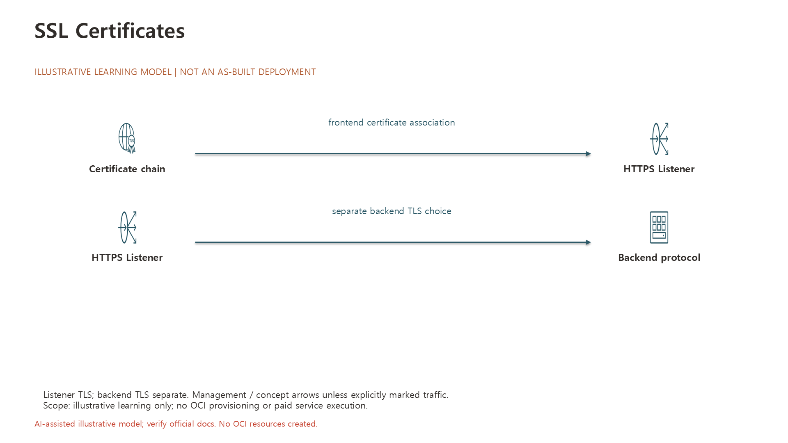

# SSL Certificates

> Draft / 작성예정 — 문서 구조 준비용 초안입니다. 완성된 실습 가이드가 아닙니다.

## 학습목표

- SSL Certificate의 HTTPS 및 SSL 종료 용도를 설명할 수 있다.[5]
- Listener의 SSL 구성과 인증서 관리 항목을 확인할 수 있다.[5]

## 대응 Roadmap 항목

- 항목명: **SSL Certificates**
- Roadmap 경로: **Load Balancer → SSL Certificates**
- Node ID: `service-lb-4`
- 상위 항목: **Load Balancer** (`service-lb-0`)
- 문서 범위: 이 항목의 개념 학습목표와 공식 출처. 실습절차 및 실행 검증은 작성예정입니다.
- [전체 항목 목록](../README.md)

## 사전준비

작성예정 — 실습 내용은 아직 작성하지 않았습니다.

## 권한

작성예정 — 실습 내용은 아직 작성하지 않았습니다.

## 비용및주의사항

작성예정 — 해당 항목의 과금 조건과 안전 주의사항을 공식문서 기준으로 확인합니다. 이 초안만으로 리소스를 생성하지 마세요. 무료 사용을 보장하지 않습니다.

## 실습구성

> 아래는 Oracle 공식문서가 설명하는 기능을 기반으로 설계한 **권장 실습안**이며 Oracle이 공인·권장한 교육과정이라는 뜻은 아닙니다. 실제 OCI 실행·검증은 수행하지 않았습니다.

- **권장 실습:** TLS 인증서 연결 설계
- **실습 방식:** Console에서 전용 실습 리소스를 관찰·구성하는 방식. 아래 활동은 구성 제안이며 상세 실행절차는 별도 작성 대상이다.
  1. 실습 도메인용 인증서의 chain·listener 연결을 검토하고 승인 시 HTTPS handshake를 확인한다
  2. 공식문서의 해당 설정·제약과 관찰값을 대조한다.
  3. 아래 결과를 기록하고 선택 생성한 리소스의 정리 범위를 확인한다.
- **확인할 결과:** 인증서 유효성·hostname·TLS 연결 확인표
- **선행/연계 실습:** [Load Balancer](00_Load_Balancer.md) — 문서 연계이며 모두 리소스 생성을 요구하는 필수 순서는 아니다.
- **주의/대체:** 로그인 가능한 OCI 계정과 해당 범위의 조회 권한이 필요하다. 생성·변경은 별도 승인된 전용 Compartment에서만 수행하며 권한·Region 지원·한도·현재 비용을 먼저 확인한다. 실습 후 생성 리소스의 삭제 대상과 보존 여부를 확인한다. 리소스가 없거나 생성 승인이 없으면 공식 예제 기반 구성표로 대체한다. LB/NLB와 backend Compute 비용·한도를 함께 확인하고 운영 endpoint를 테스트하지 않는다. certificate private key를 공개하지 않는다. 소유한 테스트 hostname과 올바른 chain만 사용한다.
- **공식 근거:** [Load Balancer- Managed SSL Certificates — SSL Certificates](https://docs.oracle.com/en-us/iaas/Content/Balance/Tasks/managingcertificates.htm)

### 학습용 구성도

> **학습용 제안 구성도**입니다. 실제 배포 현황(as-built)이나 OCI 실습 실행 결과가 아닙니다. 화살표는 그림에 표시된 요청·응답 또는 관리·개념 관계를 뜻합니다. 서비스 계열 아이콘의 정확한 Oracle Toolkit 명칭과 해석 범위는 구성 모델에 기록했습니다.

- [편집 가능한 PowerPoint](../diagrams/65-SSL-Certificates.pptx) · [구성 모델(JSON)](../diagrams/65-SSL-Certificates.json)
- 아이콘 출처: [Oracle OCI Architecture Diagram Toolkits](https://docs.oracle.com/en-us/iaas/Content/General/Reference/graphicsfordiagrams.htm). 실제 리소스를 생성하지 않은 학습 설계입니다.

## 실습절차

작성예정 — 실습 내용은 아직 작성하지 않았습니다.

## 결과검증

작성예정 — 기대 결과와 검증 방법을 정의합니다. 실제 OCI 실습 실행 및 검증은 수행하지 않았습니다.

## 문제해결

작성예정 — 실습 내용은 아직 작성하지 않았습니다.

## 리소스정리

작성예정 — 실습 내용은 아직 작성하지 않았습니다.

## 공식문서

아래 Oracle 공식문서의 해당 항목 본문을 학습 근거로 사용합니다. 목표는 학습 후 설명·구분·확인할 내용이며 실제 OCI 실행 결과를 뜻하지 않습니다.

- [5] [Load Balancer- Managed SSL Certificates — SSL Certificates](https://docs.oracle.com/en-us/iaas/Content/Balance/Tasks/managingcertificates.htm)
  - 확인 범위: SSL Certificates.
